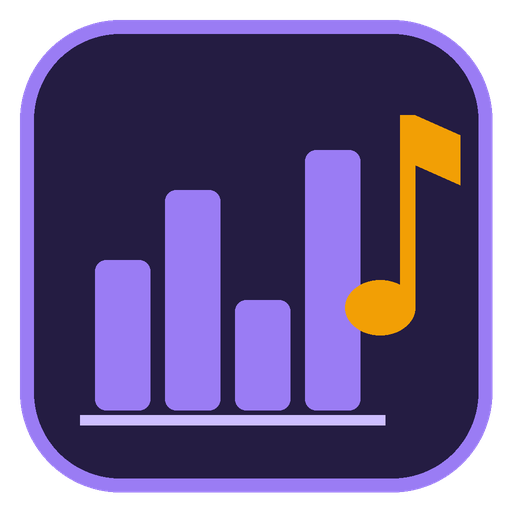
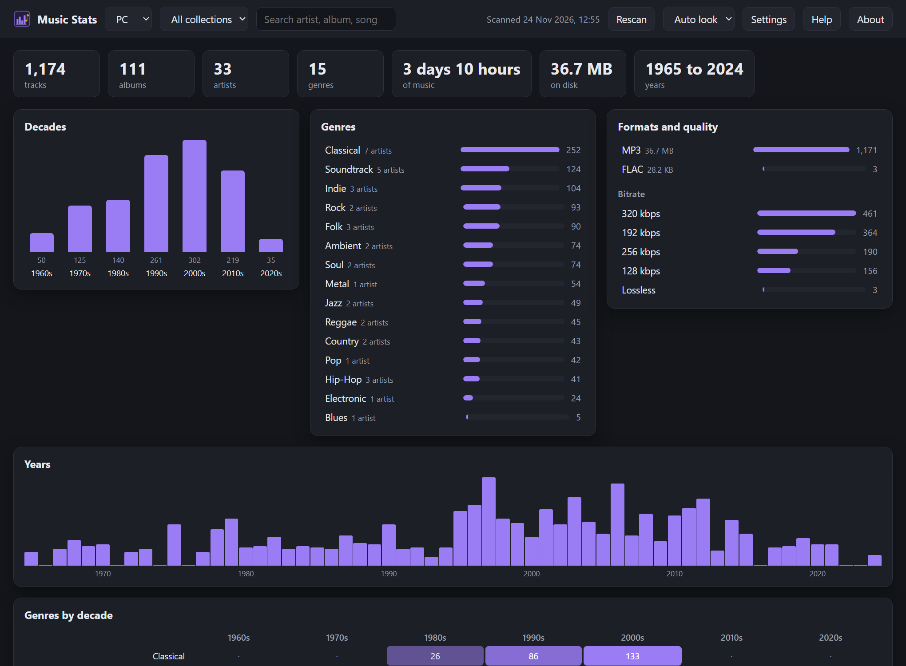
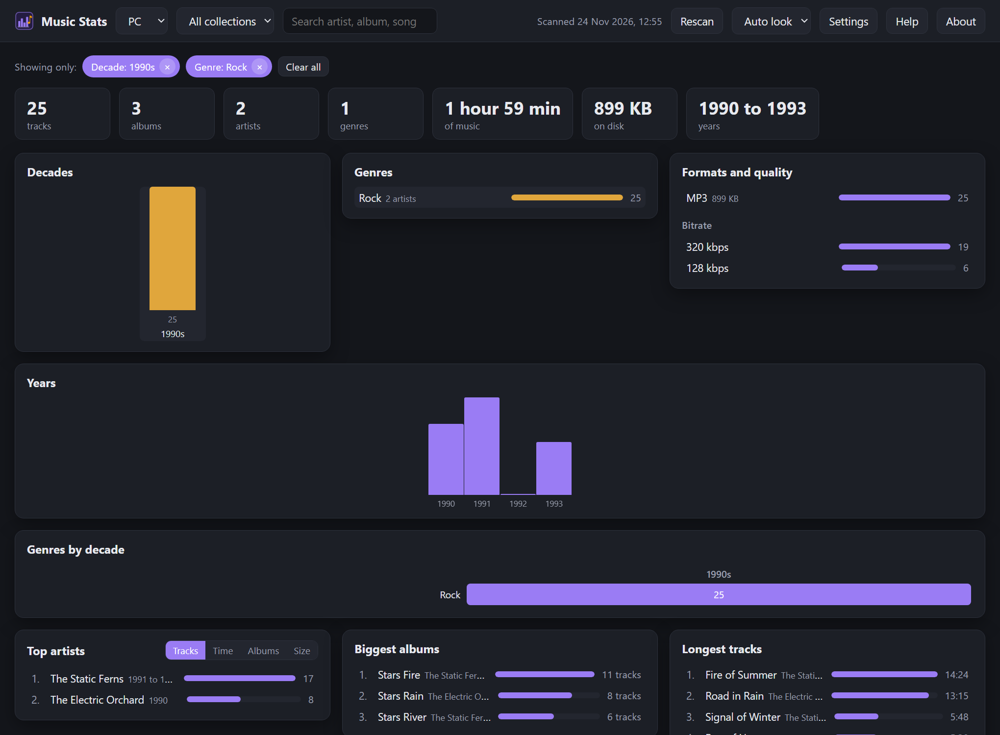
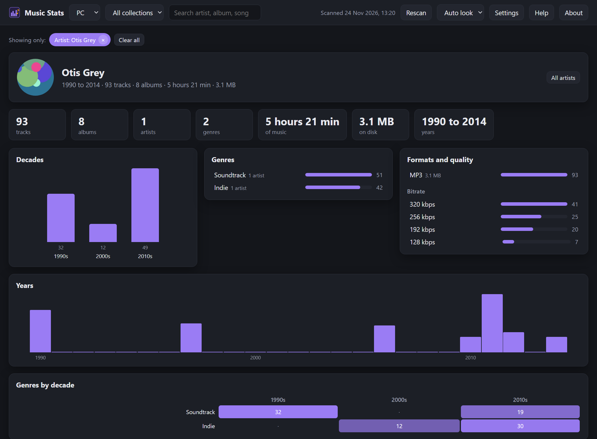
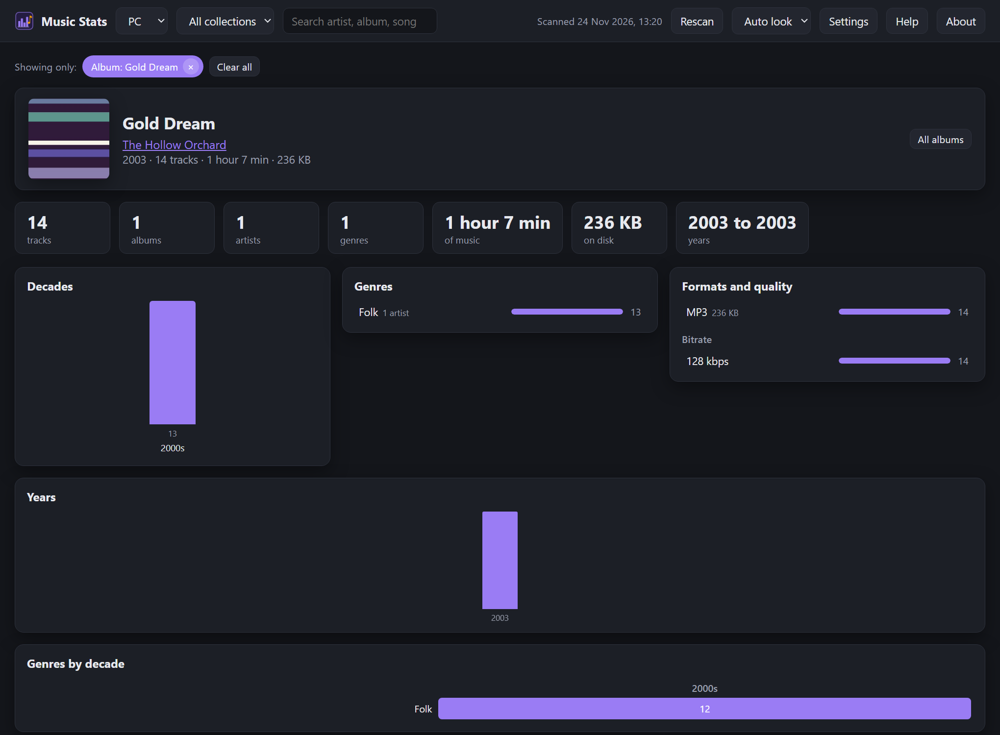
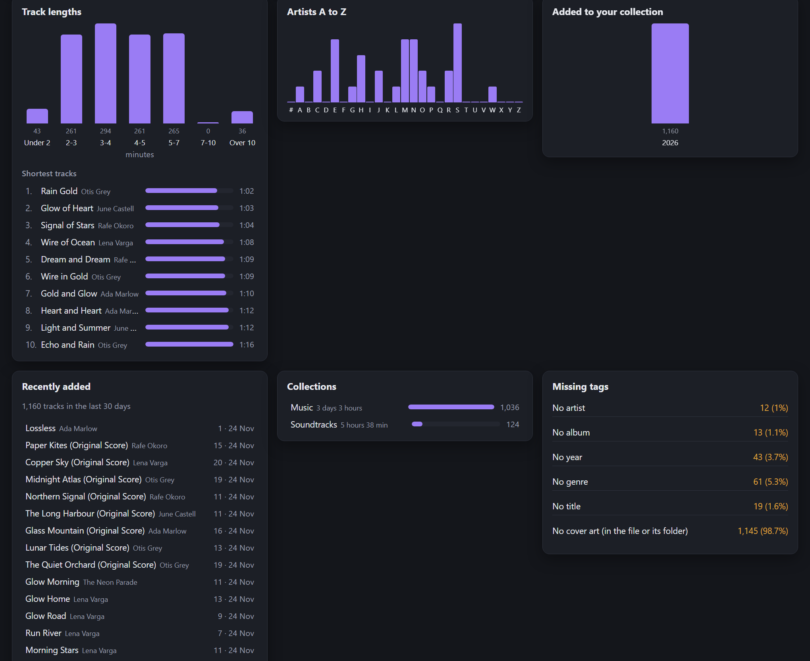
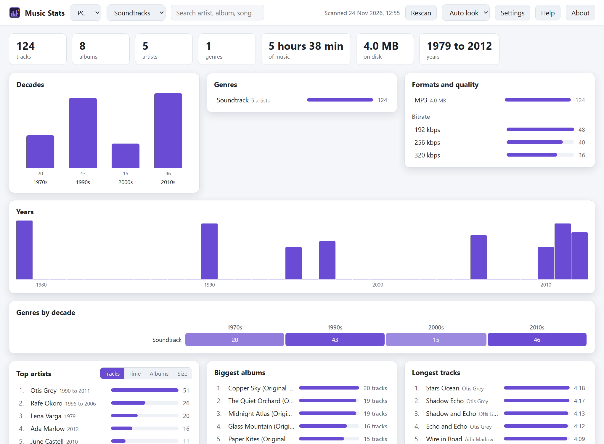
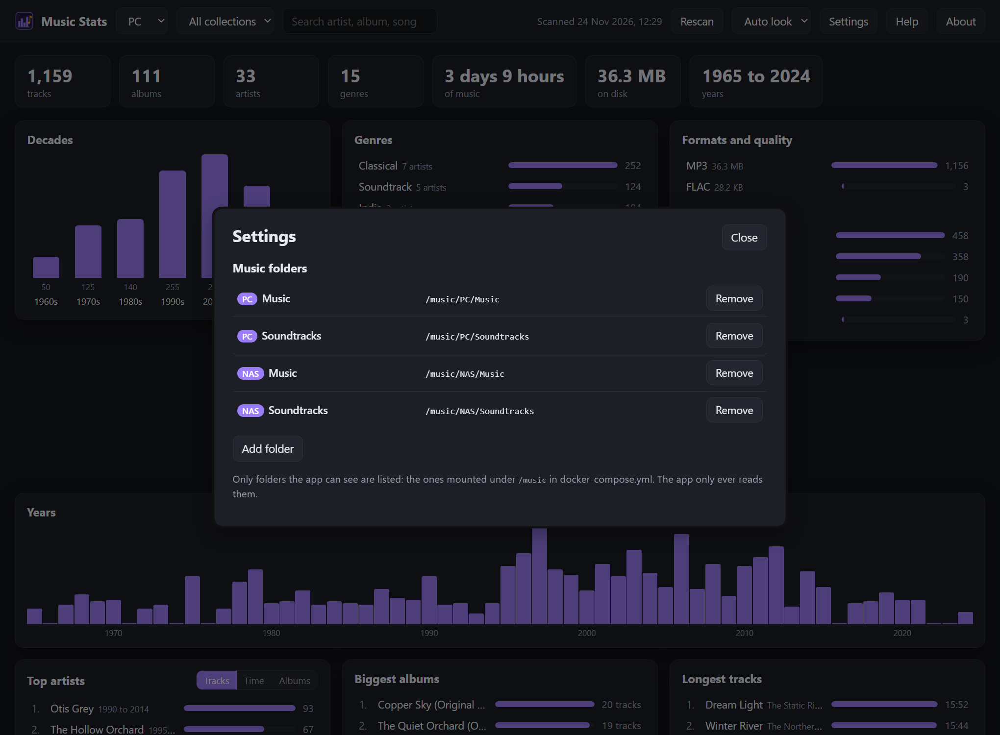

<p align="center">
  
</p>

# Music Stats

Your music collection in numbers: decades, years, genres, artists, albums and formats, read from your music's tags and run in Docker.


Music Stats reads the tags of the music in your folders (MP3, FLAC, M4A, OGG, Opus, WMA, WAV and more) and shows what's in your collection: how much of each decade and genre, who you have most of, your biggest albums, the formats and bitrates, and which files are missing tags. It only reads: it never changes, moves or tags a file.

## ✨ Features

- **Totals at a glance**: tracks, albums, artists, genres, playing time, size on disk and the years your music spans.
- **Decades and years**: a bar for each decade and a timeline of every year.
- **Genres**: the top 25, with how many artists each has.
- **Genres by decade**: a grid of your top genres across the decades; click a square to see that genre in that decade.
- **Top artists**: ranked by tracks, playing time, albums or disk space, with the years their music covers and their picture (an `artist.jpg` or `artist.png` in the artist's folder).
- **Album covers**: beside the biggest and recently added albums, from a picture beside the music (cover.jpg, folder.jpg, front.jpg and the like) or the picture inside the files. **Click an album** for its cover, artist, year, tracks, playing time and size at the top.
- **Click an artist** for their picture, years, tracks, albums, playing time and size at the top, with every chart showing just them.
- **Artists A to Z**: how many artists you have under each letter ("The Beatles" under B); click a letter to see just those.
- **Biggest albums**, **longest and shortest tracks**, **track lengths** (under 2 minutes to over 10), **formats and bitrates** (including lossless), and **when music was added** to your collection.
- **Recently added**: the albums added in the last 30 days.
- **Click to look closer**: click any decade, year, genre, artist, album or format and every chart shows just that. Pick several, such as the 1990s and Rock, and remove each with one click.
- **Pick your music folders in Settings**: browse to each folder you want read, give it a name (such as Music or Soundtracks), and see them together or one at a time. **Add folder** and **Remove** change the list at any time.
- **Libraries**: keep a copy of your music in two places, such as on a PC and on a NAS? Give each folder a library (PC or NAS) and switch between them at the top, so neither is counted twice.
- **Search**: narrow everything to an artist, album, song or genre.
- **Missing tags**: how many tracks have no artist, album, year, genre, title or cover art (in the file, or as cover.jpg, folder.jpg and the like beside it), with examples, and which artists have no picture, each with the folder its artist.jpg would go in.
- **Quick rescans**: the tags are kept in a cache, so only new and changed files are read again. Rescans at start-up, every 24 hours (or as often as you set) and when you press **Rescan**, with a progress bar and the time left. The first scan saves as it goes, so a restart part-way carries on where it was. A music folder that's missing (an unplugged drive or a sleeping NAS) keeps its tracks from the last scan.
- **Sign-in**: one username and password, a lockout after 10 wrong passwords in 15 minutes.
- Light and dark looks (or as the browser), Help and About, and `GET /healthz` for Docker and uptime monitors.

## 🖼️ Screenshots















## 📋 Requirements

- Docker with Docker Compose v2 (Docker Desktop on Windows, or Docker Engine on Linux or a NAS)
- Your music folders reachable from the Docker host
- To run without Docker: Node.js 22.12 or later

## 📦 Installation

1. Put `docker-compose.yml` and `.env.example` from this repository in a folder on the Docker host (or clone the repository).
2. Copy `.env.example` to `.env` in the same folder. Set `MUSIC_FOLDER` to your music folder (for example `D:/Music` on Windows or `/volume1/music` on a NAS), and `APP_USERNAME`, `APP_PASSWORD` and `SESSION_SECRET`. Music somewhere else too? Set `MUSIC_FOLDER_2` and remove the `#` from its line in `docker-compose.yml`. The app can see those folders and nothing else, and only reads them.
3. Nothing in `docker-compose.yml` needs changing, apart from the port if 3050 is taken.
4. Start it from that folder:

   ```
   docker compose up -d
   ```

   This pulls `jason4bury/music-stats` from Docker Hub. To build the image yourself, run `docker build -t jason4bury/music-stats .` in this repository first.
5. Open `http://<your-server>:3050` and sign in. At first each folder you mounted is read as a collection of its own; the numbers appear when the scan finishes.
6. To choose exactly which folders are read, open **Settings**, press **Add folder**, click through to a folder, name it and press **Add this folder**. **Remove** takes one off.

To use a different port on the host, change the first number in `"3050:3050"` in `docker-compose.yml`.

**Updating:** `docker compose pull` then `docker compose up -d`. The cache is kept, so nothing is read again.

## 🚀 Usage

- Click a bar or a name to see just that decade, year, genre, artist, album, format or letter (or a square in **Genres by decade** for both). What you've picked shows at the top; press its **×** to drop it, or **Clear all**.
- **Settings** picks which music folders are read (**Add folder**, **Remove**). `http://<your-server>:3050/#settings` opens it straight away.
- Pick a collection at the top, or type in the search box, to narrow everything.
- **Top artists** has **Tracks**, **Time**, **Albums** and **Size** buttons to change how they're ranked.
- In **Missing tags**, press **Show files** on a line to see the files (or **Show folders** for artists with no picture).
- **Rescan** looks for new and changed files now; progress shows beside it.

## ⚙️ Configuration

Your music folders (`MUSIC_FOLDER`, `MUSIC_FOLDER_2`) and the app settings live in `.env` next to `docker-compose.yml`; which folders inside them are read is chosen in **Settings**. The port is set in `docker-compose.yml`, which passes `.env` to the container. `.env` is gitignored; `.env.example` shows every setting.

| Setting | Required | What it does |
| --- | --- | --- |
| `MUSIC_FOLDER` | Yes | Your music folder on the Docker host, mounted read-only |
| `MUSIC_FOLDER_2` | | A second music folder (remove the `#` from its line in `docker-compose.yml`) |
| `APP_USERNAME`, `APP_PASSWORD` | Yes | The sign-in account |
| `SESSION_SECRET` | Yes | Random string of 32+ characters that signs the sign-in cookie |
| `COLLECTIONS` | | Optional: the folders to read until any are picked in Settings, as `Name=folder`, such as `Music=/music/Music, Soundtracks=/music/Soundtracks`. Without it, each folder mounted under `/music` is read |
| `MUSIC_ROOT` | | The folder Settings can browse (default `/music`; only needed without Docker) |
| `SCAN_READERS` | | How many files are read at once (default 16). More can be quicker over a network; fewer is gentler on a slow disk |
| `SCAN_HOURS` | | Look for new and changed files every this many hours (default 24; 0 means only at start-up and when you press Rescan) |

The app refuses to start if the sign-in settings are missing or still the example values, and says which one in `docker compose logs music-stats`.

**More than two places?** Add a line like the `MUSIC_FOLDER_2` one in `docker-compose.yml` (such as `${MUSIC_FOLDER_3}:/music/Third:ro`) and set it in `.env`, then pick the folders in Settings.

**The same music in two places?** When adding folders in Settings, give each a library, such as PC or NAS. The page then has a PC / NAS switch at the top and shows one library at a time, so the copies aren't added together. Either every folder has a library or none does.

**A folder on a NAS** can be mounted straight into the container as a read-only network share. In `docker-compose.yml`, add a volume such as

```yaml
volumes:
  nas-music:
    driver: local
    driver_opts:
      type: cifs
      device: //192.168.1.20/music
      o: "username=you,password=${NAS_PASSWORD},vers=3.0,ro"
```

and use `nas-music:/music/NAS:ro` in the service's volumes, with `NAS_PASSWORD` in `.env`.

### Where data is stored

The cache of tags (`library.json`) and the folders picked in Settings (`settings.json`) are in the container's `/data` folder, which is the `music-stats-data` Docker volume. To keep it in a folder instead, replace `music-stats-data` in that volume line with a path such as `D:/Docker/music-stats`. Deleting it only means the next scan reads every file again.

### Putting it on the internet

- Put it behind a reverse proxy with HTTPS (Nginx Proxy Manager, Caddy, Traefik, Synology) rather than forwarding the port from your router. The sign-in cookie is marked secure automatically when the proxy forwards HTTPS.
- Use a strong `APP_PASSWORD` and a random `SESSION_SECRET`.
- If you only need it yourself, a WireGuard or Tailscale tunnel avoids exposing it at all.

### Running without Docker

Install Node.js 22.12+, run `npm ci --omit=dev`, set `MUSIC_ROOT` in `.env` to the folder that holds your music (such as `D:/`) and start it with `npm start`. Pick the folders in Settings. The cache and settings go in `./data` unless `DATA_DIR` is set, and it listens on port 3050 unless `PORT` is set.

### Project layout

```
server/
  index.js     Express app, start-up checks, security headers, /api/stats and /api/scan
  auth.js      sign-in, sign-out and lockout
  scanner.js   reads the tags (read-only) and keeps the cache
  stats.js     turns the tracks into the numbers for the page, with filters
  settings.js  the music folders picked in Settings, and the folder browser
  version.js   shows package.json's version as v1.00
public/        the page (index.html, login.html, css/, js/app.js, js/settings.js, icons)
assets/        icon and README image
docs/          screenshots
```

Run `npm run lint` (ESLint) before committing.

## 📝 Changelog

See [CHANGELOG.md](CHANGELOG.md).

## 📄 Licence

MIT, see [LICENSE](LICENSE). Copyright (c) 2026 Jason Rhodes.

Created by Jason Rhodes, built with Claude (Anthropic).
